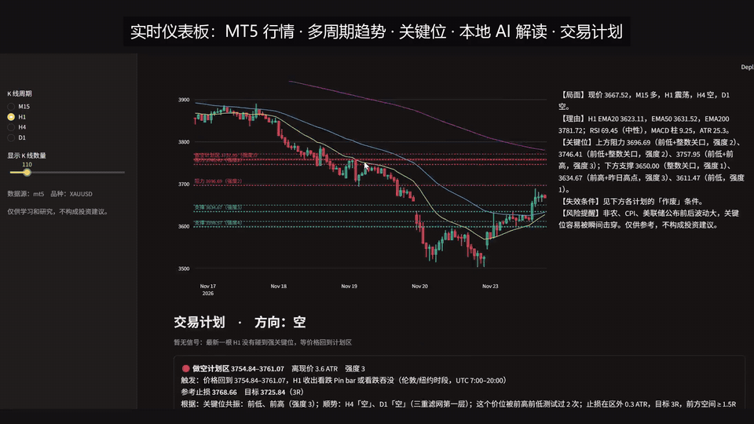
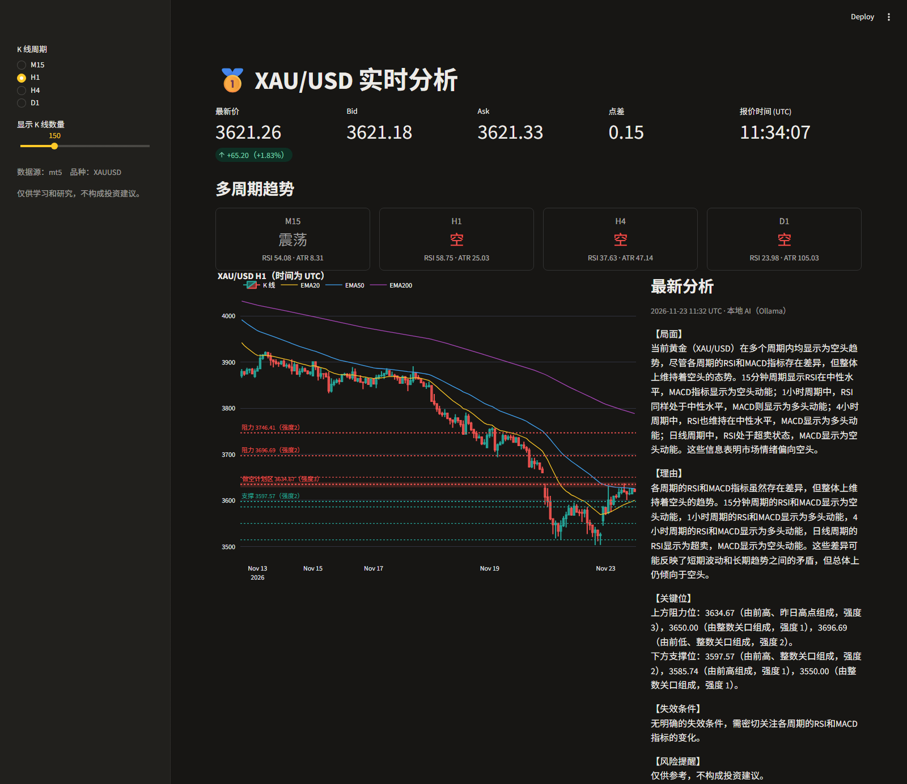
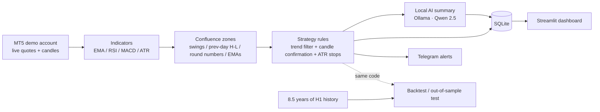
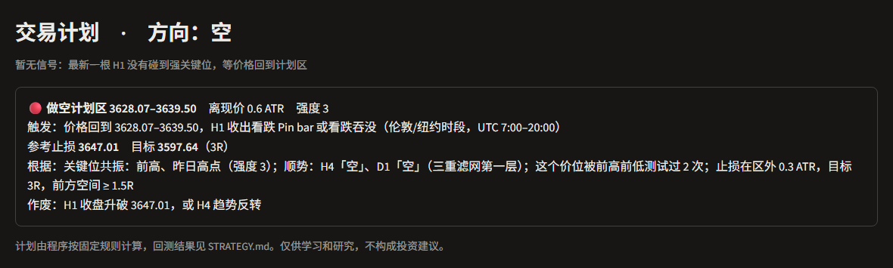
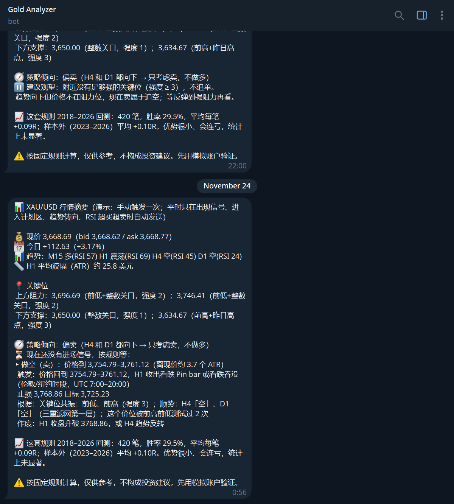

# Gold Analyzer — Real-time XAU/USD Analysis Assistant

[中文](README.md) | **English**

Reads live gold prices from MetaTrader 5, computes multi-timeframe indicators and key price levels,
builds a trading plan from a rule set **backtested on 8.5 years of data**, writes a plain-language market
summary with a **local open-source LLM**, and pushes alerts to Telegram.
Everything is free and open source and runs on your own PC. It uses no paid APIs.



🎬 Full demo video (49 s): [docs/demo.mp4](docs/demo.mp4)



## The problem

Trading gold means watching trends on several timeframes, finding support and resistance, and deciding
whether entry conditions are met. That takes time and invites emotional decisions. This tool automates it:
**code computes every number, the rules are fixed and backtestable, and the AI only explains the results.**
It notifies your phone only when something is worth looking at.

## Architecture



## Features

- **Live market data**: bid/ask, spread, daily change, and M15 / H1 / H4 / D1 candles with EMAs and key levels
- **Multi-timeframe trend**: each timeframe is classified as up, down or ranging
- **Confluence zones**: swing highs and lows, the previous day's high and low, round numbers, the H4 EMA50 and the
  H1 EMA200 are merged into zones and scored by how many sources overlap
- **Trading plan**: even without a signal, it lists the buy and sell zones to watch, with the trigger, stop,
  target, reasoning and invalidation condition for each

  
- **AI summary** in Chinese every 15 minutes, generated locally with no internet and no cost
- **Telegram alerts** for new signals, price entering a plan zone, trend changes and RSI extremes. Each alert
  includes a market snapshot, key levels, the strategy's rule-based lean and its backtest record. The same alert
  is not repeated within an hour, there is a daily cap, and alerts pause automatically while the market is closed

  
- **Backtester** that replays 8.5 years of H1 data through the same strategy code the live system runs, with an
  in-sample / out-of-sample check

## Key design decisions

1. **Code computes, the AI only explains.** An LLM guessing direction from a chart is unstable and cannot be
   backtested. Indicators, zones and signals are all computed in code; the AI only sees the computed numbers.
2. **The AI is checked for made-up content.** If its output contains a price that is not in the data, or if it
   gives its own entry or stop advice, the system falls back to a fixed text template. Indicator states
   ("overbought", "neutral") are labelled by code first, so the small model doesn't have to compare numbers.
3. **The backtest runs the live strategy code.** What is tested is exactly what runs. Only closed higher-timeframe
   bars are used; if a bar hits both the stop and the target, it counts as a loss; every trade pays a cost.
4. **Parameters are chosen first and validated afterwards, to avoid curve-fitting.** Only 12 common parameter
   sets were tried. The selection rule was fixed in advance: pick on 2018–2022, then check on 2023–2026,
   a period the selection never saw.
5. **Pluggable data sources.** `data_sources/` defines one interface. Besides MT5 there is a demo source, so the
   full pipeline and the tests run without MT5.
6. **Read-only, never trades.** There is no order-placing code anywhere; a demo account supplies the quotes.

## Backtest results (details in [STRATEGY.md](STRATEGY.md), Chinese)

| | Trades | Win rate | Avg per trade | Total | Profit factor |
|---|---|---|---|---|---|
| Full period 2018–2026 | 420 | 29.5% | +0.09R | +37.7R | 1.12 |
| Out-of-sample 2023–2026 | 203 | 29.6% | +0.10R | +20.4R | 1.14 |
| Control: no candle confirmation | 1652 | 27.5% | −0.01R | −21.3R | 0.98 |

R = one unit of risk (the distance from entry to stop).

The honest conclusion: **candle confirmation and zone confluence are the two rules that matter. The overall edge
is small and not statistically significant, and losing streaks can be long.** The tool is therefore positioned as
an analysis assistant, not a system that makes money on its own.

## Tech stack

Python · MetaTrader5 · pandas · SQLite · Ollama (Qwen 2.5) · Streamlit · Plotly · APScheduler · Telegram Bot API · pytest

## Quick start (Windows)

1. Install [MT5](https://www.metatrader5.com/) and log in to a broker **demo account**. In Market Watch, find the
   exact gold symbol name (for example `XAUUSD`).
2. Double-click `setup.bat`. It creates a virtual environment, installs dependencies and creates `.env`.
   Edit `.env` and set `MT5_SYMBOL`. To try it without MT5, set `DATA_SOURCE=demo`.
3. Optional: install [Ollama](https://ollama.com/) and run `ollama pull qwen2.5:3b`. Without it, a text template
   is used instead.
4. Optional, for Telegram: paste the token from @BotFather into `.env`, press Start in your bot, then run
   `.venv\Scripts\python.exe telegram_setup.py`.
5. Double-click `start.bat`. The dashboard opens at http://localhost:8501.

```
.venv\Scripts\python.exe watch_price.py                   # live price in the terminal
.venv\Scripts\python.exe -m app.runner --once             # run one analysis
.venv\Scripts\python.exe -m app.backtest --walkforward    # backtest + out-of-sample test
.venv\Scripts\python.exe -m pytest                        # run tests
```

Note: the analysis text and alerts are in Chinese.

## Project structure

```
app/
  config.py              reads .env
  data_sources/          base.py interface; mt5_source.py live data; demo_source.py demo data
  indicators.py          EMA, RSI, MACD, ATR, trend (same formulas as TradingView)
  levels.py              confluence zones
  strategy.py            strategy rules, trading plan, signals
  backtest.py            backtest and in-sample / out-of-sample test
  ai_analyst.py          local Ollama summary + made-up-number checks + template fallback
  messages.py            Telegram alert text
  alerts.py              Telegram delivery, de-duplication, daily cap
  db.py                  SQLite
  runner.py              main loop: fetch → compute → plan → summarise → alert
dashboard.py             Streamlit dashboard
STRATEGY.md              strategy rules and backtest results (Chinese)
tests/                   pytest tests
```

## My role

I am a gold trader. I defined the requirements, the strategy rules and the analysis framework, and I tested and
validated the results. The code was developed with the help of Claude Code.

> For learning and research only. Not investment advice. This tool only reads market data and never places orders.
