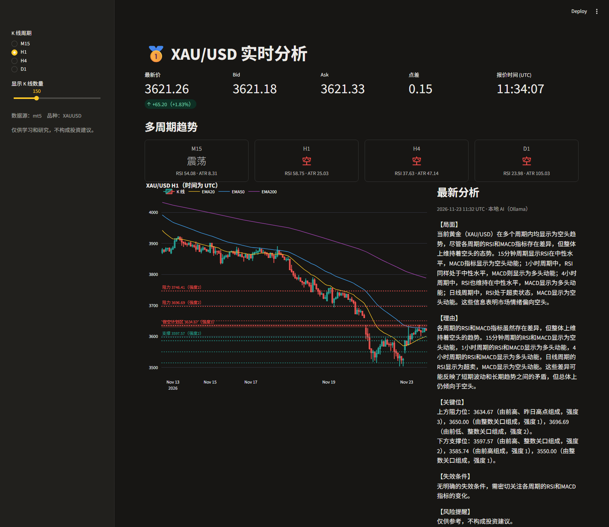

# Gold Analyzer — XAU/USD 实时自动分析工具（零成本）

从 MetaTrader 5 实时读取金价，自动计算多周期指标和支撑阻力，
用本地开源大模型生成中文市场解读，并通过 Telegram 推送关键提醒。
全部工具免费、开源，运行在本机，没有任何付费 API。

🎬 Demo 影片: https://你的影片链接


## 架构
MT5 行情 → 指标与支撑阻力 → 策略规则 → 本地 AI 解读 → Streamlit 仪表板 / Telegram

## 功能
- 实时报价（bid/ask、点差、今日涨跌）+ M15/H1/H4/D1 K 线
- EMA 20/50/200、RSI 14、MACD、ATR 14（算法与 TradingView 一致），自动支撑阻力
- 多周期趋势表（多 / 空 / 震荡）
- 每 15 分钟 AI 分析，数字全部由代码计算；AI 写了数据里没有的价位会被拦下，改用文字模板
- Telegram 提醒（新信号、碰到关键位、趋势转向、RSI 超买超卖），同一提醒 1 小时内不重复
- 信号记录（SQLite）

## 技术
Python · MetaTrader5 · pandas · SQLite · Ollama · Streamlit · Plotly · APScheduler · Telegram Bot

## 快速开始（Windows）
1. 安装 [MT5](https://www.metatrader5.com/)，登录经纪商的**模拟账户**，在「市场报价」找到金价的确切品种名。
2. 双击 `setup.bat`（建虚拟环境、装依赖、生成 `.env`）。
3. 编辑 `.env`：填 `MT5_SYMBOL`；需要手机提醒就填 Telegram token 和 chat id。
   没装 MT5 想先看效果：把 `DATA_SOURCE` 改成 `demo`。
4. （可选）安装 [Ollama](https://ollama.com/) 后运行 `ollama pull qwen2.5:7b`。没装也能用，分析会改用文字模板。
5. 双击 `start.bat`，浏览器会打开 http://localhost:8501 。

其他命令：

```
.venv\Scripts\python.exe watch_price.py        # 终端看实时价格在跳
.venv\Scripts\python.exe -m app.runner --once  # 只分析一次
.venv\Scripts\python.exe -m pytest             # 跑测试
```

### 开机自动启动
打开「任务计划程序」→「创建基本任务」→ 触发器选「当前用户登录时」→
操作选「启动程序」，程序填 `start.bat` 的完整路径，「起始于」填本文件夹路径。
MT5 也要设成开机启动（把 MT5 快捷方式放进 `shell:startup` 文件夹）。

## 文件结构
```
app/
  config.py              读 .env
  data_sources/          base.py 统一接口；mt5_source.py 真实行情；demo_source.py 演示数据
  indicators.py          EMA、RSI、MACD、ATR、趋势判断
  levels.py              支撑阻力
  strategy.py            信号规则（按 STRATEGY.md 改）
  ai_analyst.py          本地 Ollama 解读 + 文字模板备用
  alerts.py              Telegram 推送
  db.py                  SQLite
  runner.py              主程序
dashboard.py             Streamlit 仪表板
watch_price.py           终端实时价格
STRATEGY.md              交易规则
```

## 我的角色
我是金价交易者，负责策略规则、分析框架和测试；代码用 Claude Code 开发。

> 仅供学习和研究，不构成投资建议。本工具只读行情，不包含任何下单功能。
