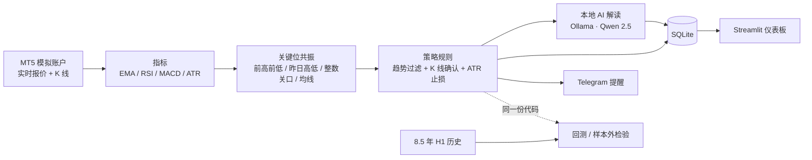
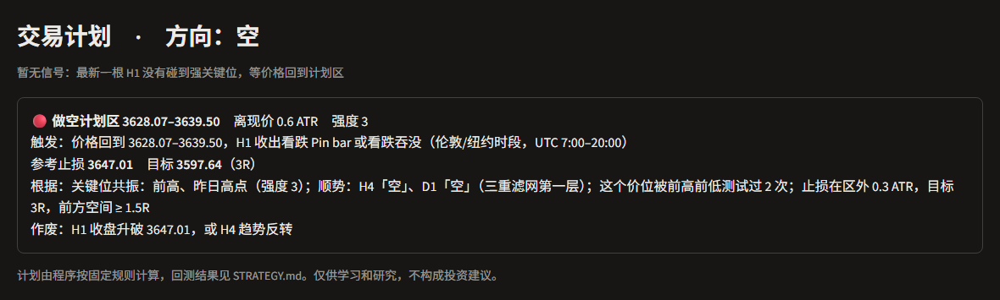

# Gold Analyzer — XAU/USD 实时自动分析工具

**中文** | [English](README.en.md)

从 MetaTrader 5 实时读取金价，自动计算多周期指标和关键位，按一套**经过 8.5 年历史回测**的规则
生成交易计划，用**本地开源大模型**写中文市场解读，并通过 Telegram 推送提醒。
全部工具免费、开源，运行在本机，没有任何付费 API。


<!-- Demo 影片：上传后取消注释
🎬 Demo 影片：https://你的影片链接
-->

## 解决什么问题

看金价时要同时盯几个周期的趋势、找支撑阻力、判断有没有进场条件，很花时间也容易情绪化。
这个工具把这些步骤自动化：**数字由代码算，规则固定且可回测，AI 只负责把结果写成人话**，
有值得注意的情况才推送到手机。

## 系统架构



## 功能

- **实时行情**：报价、点差、今日涨跌；M15 / H1 / H4 / D1 K 线，叠加 EMA 和关键位
- **多周期趋势**：每个周期判断多 / 空 / 震荡
- **关键位共振**：把前高前低、昨日高低点、整数关口、H4 EMA50、H1 EMA200 合并成「区」并打强度分
- **交易计划**：没有信号时也会列出该关注的做多 / 做空区、触发条件、止损、目标、根据和作废条件

  
- **AI 中文解读**：每 15 分钟一次，本地运行、不联网、不收费
- **Telegram 提醒**：新信号、进入计划区、趋势转向、RSI 超买超卖；附带行情、关键位、策略倾向和回测成绩；
  同一提醒 1 小时内不重复、每天有上限、休市时自动暂停
- **历史回测**：用实时分析的同一份策略代码重放 8.5 年 H1 数据，含样本内 / 样本外检验

## 几个关键设计决定

1. **数字由代码算，AI 只解读。** AI 直接看图猜方向不稳定、不能回测。指标、关键位、信号全部由代码计算；
   AI 只拿到算好的数字写解读。
2. **防止 AI 编造。** AI 输出里出现数据里没有的价位、或自己写了进场 / 止损建议，就自动改用文字模板。
   给小模型的数据先由代码标好「超买 / 中性」等状态，避免它比较数字出错。
3. **回测和实盘用同一份策略代码。** 回测测的就是实际在跑的规则；只用已收盘的大周期 K 线，
   同一根 K 线同时碰到止损和目标算止损，每笔扣成本。
4. **先选参数、后验证，避免事后拟合。** 只试 12 组常见参数，事先定好挑选规则，
   用 2018–2022 挑参数，再用没看过的 2023–2026 检验。
5. **数据源可替换。** `data_sources/` 统一接口，MT5 之外还有演示数据源，没有 MT5 也能跑通全流程和测试。
6. **只读，不下单。** 程序里没有任何下单代码，用模拟账户读行情。

## 回测结果（详见 [STRATEGY.md](STRATEGY.md)）

| | 笔数 | 胜率 | 平均每笔 | 合计 | PF |
|---|---|---|---|---|---|
| 全期 2018–2026 | 420 | 29.5% | +0.09R | +37.7R | 1.12 |
| 样本外 2023–2026 | 203 | 29.6% | +0.10R | +20.4R | 1.14 |
| 对照：去掉 K 线确认 | 1652 | 27.5% | −0.01R | −21.3R | 0.98 |

结论如实写：**K 线确认和关键位共振是有效的两条规则；整体优势很小、统计上未显著，会长时间连亏。**
所以它定位为分析助手，而不是自动赚钱的系统。

## 技术

Python · MetaTrader5 · pandas · SQLite · Ollama（Qwen 2.5）· Streamlit · Plotly · APScheduler · Telegram Bot API · pytest

## 快速开始（Windows）

1. 安装 [MT5](https://www.metatrader5.com/)，登录经纪商的**模拟账户**，在「市场报价」找到金价的确切品种名。
2. 双击 `setup.bat`（建虚拟环境、装依赖、生成 `.env`），编辑 `.env` 填 `MT5_SYMBOL`。
   没装 MT5 想先看效果：把 `DATA_SOURCE` 改成 `demo`。
3. （可选）安装 [Ollama](https://ollama.com/) 后 `ollama pull qwen2.5:3b`。没装也能用，分析会改用文字模板。
4. （可选）Telegram：把 @BotFather 给的 token 贴进 `.env`，给机器人按 Start，
   再运行 `.venv\Scripts\python.exe telegram_setup.py`。
5. 双击 `start.bat`，浏览器打开 http://localhost:8501 。

```
.venv\Scripts\python.exe watch_price.py                   # 终端看实时价格
.venv\Scripts\python.exe -m app.runner --once             # 只分析一次
.venv\Scripts\python.exe -m app.backtest --walkforward    # 回测 + 样本外检验
.venv\Scripts\python.exe -m pytest                        # 跑测试
```

开机自动启动：「任务计划程序」→「创建基本任务」→ 触发器「当前用户登录时」→
「启动程序」填 `start.bat` 的完整路径、「起始于」填本文件夹。MT5 也要设成开机启动。

## 文件结构

```
app/
  config.py              读 .env
  data_sources/          base.py 统一接口；mt5_source.py 真实行情；demo_source.py 演示数据
  indicators.py          EMA、RSI、MACD、ATR、趋势判断（算法与 TradingView 一致）
  levels.py              关键位共振
  strategy.py            策略规则、交易计划、信号
  backtest.py            历史回测、样本内 / 样本外检验
  ai_analyst.py          本地 Ollama 解读 + 防编造检查 + 文字模板备用
  messages.py            Telegram 提醒内容
  alerts.py              Telegram 推送、去重、每日上限
  db.py                  SQLite
  runner.py              主程序：定时拿行情 → 算 → 计划 → 解读 → 提醒
dashboard.py             Streamlit 仪表板
STRATEGY.md              交易规则和回测结果
tests/                   pytest 测试
```

## 我的角色

我是金价交易者，负责需求、策略规则、分析框架和测试验证；代码用 Claude Code 协助开发。

> 仅供学习和研究，不构成投资建议。本工具只读行情，不包含任何下单功能。
